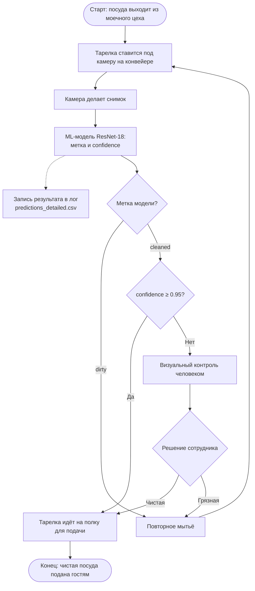

# Model_BPMN: место ML-модели в бизнес-процессе

## 1. Бизнес-процесс

**Процесс:** контроль чистоты посуды после мытья на предприятии общественного питания или в клининговой компании.

**Цель:** подавать гостям только чистую посуду, снизить зависимость от человеческого фактора и ускорить приёмку.

**Участники:** мойщик посуды или конвейер, камера, ML-модель (`ML Plates Classifier`), сотрудник контроля.

**Результат процесса:** чистая тарелка на полке для подачи. Грязная возвращается в мойку.

## 2. Схема процесса

Схема отображается на GitHub автоматически. Решающая логика реализована в коде: функция `decide` в `src/plates/predict.py`.

## 3. Шаги процесса

| Шаг | Что происходит | Результат, который передаётся дальше |
|---|---|---|
| 1. Старт | Посуда проходит моечный цех | Вымытая тарелка |
| 2. Подача под камеру | Сотрудник или манипулятор ставит тарелку на конвейер под камеру | Тарелка в зоне съёмки |
| 3. Съёмка | Камера делает снимок | Изображение RGB (JPG или PNG) |
| 4. Классификация | Модель обрабатывает изображение | Метка (`cleaned` / `dirty`) и `confidence` |
| 5. Развилка | Решение по метке и порогу 0.95 | Действие: подача, ручная проверка или мытьё |
| 6. Ручной контроль | Человек смотрит снимок и тарелку | Окончательное решение: чистая или грязная |
| 7. Конец | Чистая тарелка на полке | Посуда подана |

## 4. Какую задачу в процессе решает модель

Модель — автоматический инспектор. Она решает задачу бинарной классификации: по снимку определяет, чистая тарелка или грязная, и сообщает, насколько уверена. Она **не принимает окончательных решений** о подаче: при низкой уверенности вердикт выносит человек, а грязные тарелки возвращаются в мойку.

## 5. Почему для этой задачи целесообразно использовать ML

- **Разнообразие загрязнений.** Жир, остатки пищи, пятна и разводы выглядят по-разному, освещение и рисунок на тарелках меняются. Правила на основе порогов цвета или яркости такие случаи ловят плохо, а нейросеть извлекает признаки из примеров.
- **Мало данных для обучения.** Transfer Learning (ResNet-18, предобученная на ImageNet) позволяет обучить только последний слой на небольшой выборке.
- **Скорость и единообразие.** Модель обрабатывает снимок за доли секунды и применяет один и тот же критерий, без усталости. Человек остаётся для сложных случаев.
- **Асимметричная цена ошибки.** Ошибка «грязная принята за чистую» хуже, чем лишний ручной контроль, поэтому в процесс встроен порог уверенности, который легко менять в конфиге.

Честная оговорка: на текущем учебном наборе (40 изображений) качество невысокое, см. [model_card.md](model_card.md). ML оправдан как предварительный фильтр поверх контроля человеком, а не как замена ему.

## 6. Данные, которые поступают на вход модели

- **Изображение** одной тарелки: цветное, RGB, JPG или PNG, снимок сверху или под небольшим углом.
- **Предобработка перед моделью:** изменение размера до 224 × 224, нормализация статистиками ImageNet.
- **Идентификатор снимка** (имя файла) для связи результата с конкретной тарелкой.
- Другие данные (вес, температура, время мытья) модель не использует.

## 7. Как результат модели используется дальше

Модель возвращает метку и `confidence`, из них формируется решение:

| Метка | confidence | Решение | Действие в процессе |
|---|---|---|---|
| `cleaned` | ≥ 0.95 | `serve` | Тарелка отправляется на полку для подачи |
| `cleaned` | < 0.95 | `manual_review` | Тарелка идёт на визуальный контроль человеком |
| `dirty` | любое | `rewash` | Тарелка возвращается на повторное мытьё |

- Порог 0.95 задаётся в `configs/config.yaml` (`inference.confidence_threshold`).
- Каждое предсказание записывается в лог (`predictions_detailed.csv`: `id`, `label`, `confidence`, `decision`). Эти данные используются для мониторинга: доли ручных проверок, средней уверенности, сигналов деградации. Они запускают процесс переобучения, см. [Model_retrain_BPMN.md](Model_retrain_BPMN.md).
- Решения сотрудников при ручном контроле дают новые размеченные примеры для будущих версий модели.

## 8. Условия вывода в эксплуатацию (предложение)

Текущая версия `v1.0` — учебный прототип (F1 = 0.73 на 8 валидационных изображениях). Для реального запуска предлагается как минимум:
1. Собрать размеченную выборку из целевых условий и оценить модель на независимом тесте.
2. Откалибровать уверенность и подобрать порог на реальных данных.
3. Начать с режима «тень» без влияния на процесс, затем перейти к канареечному запуску с обязательным ручным контролем сомнительных случаев.

Конкретные числовые пороги принятия модели приведены в [Model_retrain_BPMN.md](Model_retrain_BPMN.md).
