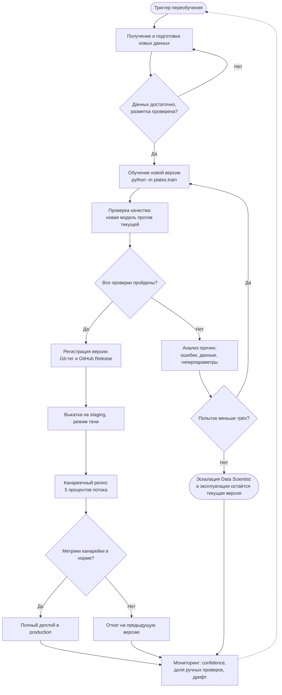

# Model_retrain_BPMN: процесс автоматического переобучения модели

## 1. Описание

Документ описывает жизненный цикл ML-модели `ML Plates Classifier` от момента, когда возникла необходимость обновить модель, до развёртывания новой версии в эксплуатации (или отказа от неё). Процесс опирается на то, что уже есть в проекте: конфиг `configs/config.yaml`, обучение `python -m plates.train`, артефакты `models/best_model.pth` и `models/metrics.json`, проверки CI (GitHub Actions), метрики из [model_card.md](model_card.md) и решающую логику из [Model_BPMN.md](Model_BPMN.md).

## 2. Схема процесса

## 3. Основные этапы

### 1. Триггер запуска переобучения

**Что происходит.** Процесс запускается автоматически или вручную при одном из событий:
- **Деградация качества.** На выборке, размеченной сотрудниками при ручном контроле, F1 для класса `dirty` ниже 0.80 (основная метрика та же, что в model card).
- **Дрейф данных или уверенности.** Доля решений `manual_review` за неделю выше 30 % или средняя уверенность упала на 10 п.п. и более относительно эталонной недели; изменились условия съёмки (освещение, новые типы тарелок).
- **Расписание.** Плановое переобучение раз в месяц.
- **Ручной запрос.** Специалист обнаружил системную проблему.

**Результат → следующему шагу:** тикет или запуск пайплайна с указанием причины и периода данных.

### 2. Получение и подготовка новых данных

**Что происходит.**
- Сбор снимков из production и результатов ручного контроля (они служат разметкой).
- Проверка разметки, удаление дубликатов и утечек между train и val.
- Стратифицированное разбиение на train / val / test, чтобы классы были представлены в каждой части. Тестовая часть с метками не используется при обучении и выборе эпохи.
- Размещение данных в `data/raw/plates/` (в Git данные не кладутся).

**Результат → следующему шагу:** версионированный набор данных с описанием (число изображений по классам, период, источник). Если данных недостаточно (нет достаточного числа примеров каждого класса), этап повторяется.

### 3. Обучение новой версии модели

**Что происходит.** Запуск `poetry run python -m plates.train --config configs/config.yaml`. Гиперпараметры берутся из конфига. Воспроизводимость обеспечивают фиксированный seed, отсортированный список файлов и `poetry.lock`. Лучшая эпоха выбирается по F1 на валидации.

**Результат → следующему шагу:** артефакты `models/best_model.pth` (веса), `models/metrics.json` (метрики, эпоха, конфиг, дата).

### 4. Проверка качества модели

**Что происходит.** Модель-кандидат (Challenger) сравнивается с текущей production-версией (Champion) на **одном и том же** независимом размеченном тестовом наборе. Проверки:
1. **Качество:** F1 кандидата не ниже F1 текущей модели более чем на 0.02 вперёд, то есть F1(Challenger) ≥ F1(Champion) + 0.02.
2. **Безопасность:** Recall для `dirty` не ниже 0.90 и не хуже текущей модели.
3. **Калибровка:** среди предсказаний `cleaned` с confidence ≥ 0.95 доля ошибок не выше 2 %.
4. **Инженерные проверки:** `pre-commit` и `pytest` проходят в CI (GitHub Actions), дымовой запуск `predict` на нескольких снимках выдаёт колонки `id`, `label`, `confidence`, `decision`.

Числовые пороги даны как стартовые предложения и должны согласовываться с владельцем процесса.

**Результат → следующему шагу:** отчёт сравнения (метрики Challenger и Champion) и вердикт «пройдено / не пройдено».

### 5. Принятие решения о возможности публикации новой версии

**Что происходит.** Шлюз «Все проверки пройдены?». Модель одобряется только если выполнены **все** условия этапа 4.

**Если проверки не пройдены (действия при неуспехе).**
1. Анализ причин: просмотр ошибок на тесте, баланс классов, качество разметки, признаки переобучения (рост val loss при падающем train loss).
2. Корректировка данных или гиперпараметров (аугментации, число эпох, размораживание части backbone) и повторное обучение.
3. После трёх неудачных попыток: эскалация специалисту. Новая версия не публикуется, в эксплуатации остаётся текущая модель.

**Результат → следующему шагу:** решение «публиковать» (переход к регистрации) или «отклонить» (возврат на доработку либо эскалация).

### 6. Регистрация и сохранение новой версии модели

**Что происходит.**
- Присвоение версии по схеме `vMAJOR.MINOR.PATCH` (текущая: `v1.0.0`) и Git-тег коммита, на котором модель обучена.
- Публикация GitHub Release с прикреплёнными `best_model.pth` и `metrics.json` (веса в репозитории не хранятся).
- Запись метаданных: дата, автор, версия данных, конфиг, метрики, ссылка на коммит. Обновление [model_card.md](model_card.md).

**Результат → следующему шагу:** зарегистрированная версия с воспроизводимым набором артефактов. При необходимости их можно перенести в Model Registry (MLflow, DVC), но для проекта достаточно тегов и Releases.

### 7. Деплой модели

**Что происходит.**
1. Выкатка на staging и работа в режиме тени: модель получает реальные снимки, но её решения не влияют на процесс.
2. Канареечный релиз: 5 процентов потока обрабатывает новая модель, остальное текущая.
3. Если метрики канарейки в норме (доля ручных проверок и F1 на размеченной выборке не хуже текущей модели), выкатывается 100 % трафика.
4. Если метрики хуже, автоматический откат на предыдущую версию по тегу.

**Результат → следующему шагу:** новая версия в production (либо возвращённая предыдущая) и включённый мониторинг.

### 8. Мониторинг (обратная связь)

**Что происходит.** Сбор логов инференса (`id`, `label`, `confidence`, `decision`), расчёт доли ручных проверок, распределения уверенности, F1 по размеченной выборке. Сигналы выхода метрик за пороги (см. этап 1) снова запускают процесс.

**Результат:** замкнутый цикл, новые данные и результаты ручного контроля попадают в следующий цикл переобучения.

## 4. Когда новая версия попадает в эксплуатацию

Только если одновременно выполнено всё:
- кандидат прошёл все проверки этапа 4 (качество, безопасность, калибровка, CI);
- версия зарегистрирована (тег и Release с артефактами);
- прошёл режим тени и канареечный релиз без ухудшения метрик.

В противном случае в эксплуатации остаётся текущая версия.
